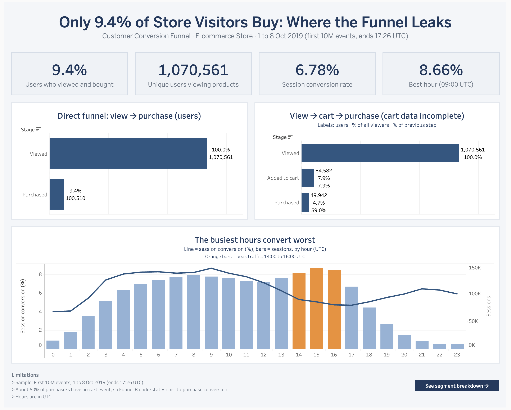
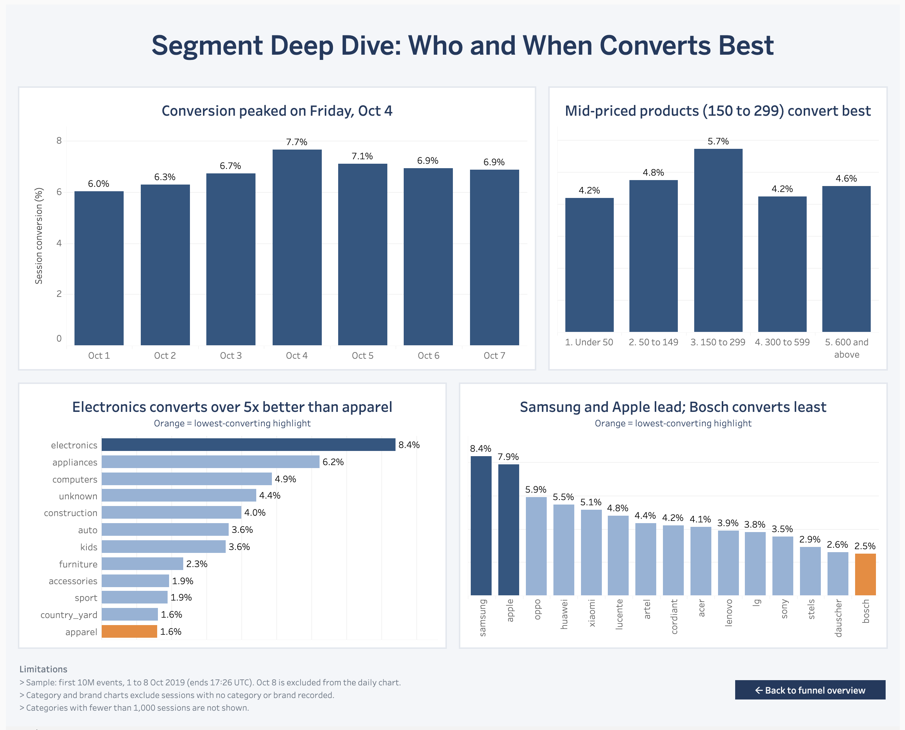

# Customer Conversion Funnel Analysis: E-commerce Store (Oct 2019)

**SQL (SQLite) + Tableau Public | 10 million behavioural events | 1.07 million users | 2.15 million sessions**

Skills used here: SQL, data cleaning, funnel and cohort-style analysis, Tableau, data storytelling.

**Live dashboard:** [Customer Conversion Funnel on Tableau Public](https://public.tableau.com/app/profile/tasnim.khan7515/viz/CustomerConversionFunnel-E-commerce/FunnelOverview)



---

## TL;DR

An online electronics-heavy store converts **9.4% of the users who view a product into buyers** (6.78% at session level). The analysis shows where that conversion is won and lost:

- **The busiest hours convert worst.** Sessions at 14:00 to 16:00 UTC convert at roughly 5%, against 8.0 to 8.7% between 04:00 and 10:59 UTC.
- **Electronics carries the store.** It converts at 8.41% and produces about 57% of all converted sessions. Apparel, with 62,784 sessions, converts at only 1.60%.
- **Two brands drive the volume.** Samsung (8.36%) and Apple (7.88%) account for about 43% of converted sessions. Bosch draws 49,702 sessions but converts at 2.52%.
- **The cart stage cannot be trusted.** About 50% of buyers have no cart event, so cart-based funnels understate conversion. I report a direct view-to-purchase funnel as the headline and the cart-based funnel as a caveated secondary view.

---

## Business Question

> Where do customers drop off between viewing a product and buying it, and which categories, brands, price bands, and times of day convert best?

The goal is to help a marketing or e-commerce team decide where to focus conversion work (offers, checkout, product pages, ad spend).

---

## Dataset

| Item | Detail |
|---|---|
| Source | [eCommerce behavior data from multi category store](https://www.kaggle.com/datasets/mkechinov/ecommerce-behavior-data-from-multi-category-store) (REES46, via Kaggle) |
| File used | `2019-Oct.csv` (about 5.6 GB uncompressed) |
| Sample analysed | **First 10,000,000 events**, 1 Oct 2019 00:00:00 to 8 Oct 2019 17:26:09 UTC |
| Why a sample | The full file has about 42 million rows. A continuous time slice keeps each user's and session's events intact, so funnels stay valid (random row sampling would break them). |
| Event types in sample | `view` 9,627,820 · `cart` 199,354 · `purchase` 172,826 (`remove_from_cart` does not occur in this slice) |
| Unique users / sessions | 1,070,614 users · 2,148,766 sessions |
| Columns | `event_time`, `event_type`, `product_id`, `category_id`, `category_code`, `brand`, `price`, `user_id`, `user_session` |

The raw file is not included in this repository because of its size. Download it from Kaggle (link above).

---

## Tools

- **SQLite** for loading, cleaning, and aggregating 10M rows (DB Browser for SQLite for query development)
- **Tableau Public** for the two-page dashboard
- **Terminal (`head`, `sqlite3`)** for sampling and import
- Platform: macOS

---

## Approach

1. **Sample and load.** Took the first 10M rows of the October file and imported them into SQLite with explicit column types.
2. **Profile and clean.** Checked row counts, event types, date range, missing values, and price validity. Built `events_clean` with derived `event_date`, `event_hour`, and `main_category` columns.
3. **Build the funnel.** Created a one-row-per-user table (`user_funnel`) with view / cart / purchase flags, then calculated user-level funnels.
4. **Validate the funnel.** Found that more users purchased than added to cart, investigated, and tested whether it was a sample-window effect (it was not). See [Data Quality](#data-quality-and-limitations).
5. **Segment.** Built session-level tables (`session_funnel`, `session_category`, `session_brand`) and calculated conversion by hour, day, main category, price band, and brand.
6. **Publish summary tables.** Exported six small summary tables as CSVs and built the dashboard in Tableau Public (they are in [`data/`](data/)).

### Metric definitions

| Metric | Definition | Value |
|---|---|---|
| Direct user conversion | Users who viewed a product **and** purchased, divided by users who viewed a product | 100,510 / 1,070,561 = **9.4%** |
| Session conversion | Sessions with a product view **and** a purchase, divided by sessions with a product view | 145,762 / 2,148,385 = **6.78%** |

Both are correct. They differ because a user can have several sessions during the week, so always check which one a chart uses. Segment-level session rates (category, brand, price band) are not additive, because a session that views several categories counts as a view in each, while its purchase counts only in the category bought.

### Data cleaning decisions

| Issue | Size | Decision |
|---|---|---|
| Missing `category_code` | 3,224,119 rows (32%) | Kept; labelled `unknown`. Excluded from category findings. |
| Missing `brand` | 1,387,109 rows (14%) | Kept; labelled `unknown`. Excluded from the brand ranking. |
| Zero price | 15,522 rows (0.16%); all `view` (15,514) or `cart` (8), **no purchases** | Kept for funnel counts; price set to `NULL` so averages are not distorted. |
| Valid price range | 0.79 to 2,574.07 (mean about 296.52) | No outliers filtered. |
| Partial last day (8 Oct, ends 17:26 UTC) | n/a | Excluded from the day-by-day chart only. |
| Categories with fewer than 1,000 sessions | `country_yard`, `medicine`, `stationery` | Dropped from the category chart because the rates are unreliable. |

---

## Key Findings

### 1. The funnel

| Funnel | Stage | Users | Rate |
|---|---|---|---|
| **A. Direct (headline)** | Viewed | 1,070,561 | 100% |
| | Purchased | 100,510 | **9.4%** |
| **B. Cart-based (caveated)** | Viewed | 1,070,561 | 100% |
| | Viewed, then added to cart | 84,582 | 7.9% |
| | Viewed, carted, then purchased | 49,942 | 4.7% overall, **59.1%** of carted users |

Funnel B undercounts conversion because of the cart-tracking gap described below.

### 2. Time of day (session conversion, UTC)

| Window | Conversion | Note |
|---|---|---|
| 04:00 to 10:59 | 8.0 to 8.7% (peak **8.66% at 09:00**) | Strongest period |
| 14:00 to 16:00 | about 4.7 to 5.3% | **Busiest hours** (137k to 147k sessions each) |
| 00:00 to 01:59 | about 4.0% | Lowest volume and lowest conversion |

### 3. Day of week (session conversion)

| Tue 1 Oct | Wed 2 Oct | Thu 3 Oct | **Fri 4 Oct** | Sat 5 Oct | Sun 6 Oct | Mon 7 Oct |
|---|---|---|---|---|---|---|
| 6.02% | 6.30% | 6.72% | **7.66%** | 7.12% | 6.93% | 6.88% |

Friday was the best and busiest day. With one week of data this is an observation, not a weekly pattern.

### 4. Category

| Category | Sessions viewed | Conversion |
|---|---|---|
| **Electronics** | 994,882 | **8.41%** |
| Appliances | 248,096 | 6.23% |
| Computers | 121,551 | 4.87% |
| Auto | 81,828 | 3.63% |
| Kids | 33,953 | 3.56% |
| Furniture | 61,254 | 2.33% |
| **Apparel** | 62,784 | **1.60%** |

Electronics produces about **57%** of converted sessions (83,652 of 145,762) and converts more than 5 times better than apparel.

### 5. Brand (top 15 by traffic, brand known)

| Brand | Sessions viewed | Conversion |
|---|---|---|
| **Samsung** | 410,556 | **8.36%** |
| **Apple** | 365,362 | **7.88%** |
| Xiaomi | 228,217 | 5.14% |
| Huawei | 94,525 | 5.45% |
| **Bosch** | 49,702 | **2.52%** |

Samsung and Apple together produce about **43%** of converted sessions (63,145 of 145,762).

### 6. Price band

| Under 50 | 50 to 149 | **150 to 299** | 300 to 599 | 600 and above |
|---|---|---|---|---|
| 4.20% | 4.75% | **5.72%** | 4.23% | 4.56% |

Conversion peaks in the middle band instead of rising or falling steadily. Price band overlaps with category (electronics skews expensive), so price alone should not be treated as the driver.

---

## Recommendations

Each recommendation is a hypothesis to test, not a proven cause. The data covers one week and has no user attributes (device, channel, location), so it shows *where* conversion differs but not *why*.

### 1. Test improvements for peak-traffic hours
- **Finding:** Sessions at 14:00 to 16:00 UTC are among the busiest of the day but convert at about 5%, against 8.0 to 8.7% in the morning.
- **Why it matters:** Because volume is highest at these hours, even a small gain converts many more sessions.
- **What to test:** Run an A/B test of a faster checkout flow or a time-limited offer in the afternoon window. Success metric: session conversion for 14:00 to 16:00 UTC against a control group.

### 2. Diagnose the low-converting, high-traffic segments
- **Finding:** Apparel (1.60%, 62,784 sessions), furniture (2.33%), and Bosch (2.52%, 49,702 sessions) attract real traffic but rarely convert.
- **Why it matters:** Ad or promotion spend sent to these segments is likely less efficient than spend on electronics.
- **What to test:** Review product pages, pricing, delivery information, and stock availability for these segments, and compare against the best-converting ones before increasing traffic to them.

### 3. Protect the segments that carry revenue
- **Finding:** Electronics produces about 57% of converted sessions, and Samsung plus Apple about 43%.
- **Why it matters:** Conversion is concentrated, so stock-outs or weak promotion in these segments would hurt results far more than anywhere else.
- **What to test:** Track availability and promotion coverage for the top brands, and monitor their conversion as a leading indicator.

### 4. Experiment with mid-priced product placement
- **Finding:** Sessions viewing products priced 150 to 299 convert best (5.72%), against 4.2% for items under 50.
- **Why it matters:** If the effect holds, surfacing mid-priced items could lift overall conversion.
- **What to test:** Feature mid-priced items on category landing pages for a test group. Control for category, since electronics also skews higher-priced.

### 5. Fix cart-event tracking before trusting cart metrics
- **Finding:** About 50% of purchasers (50,592 of 100,545) have no cart event, on every day of the sample (39.8% to 62.3%).
- **Why it matters:** Cart abandonment and cart-to-purchase rates are unreliable until this is explained, and any cart-based experiment would be mis-measured.
- **What to test:** Ask the data or engineering team whether some purchase paths (for example "buy now") skip the cart event, and audit event logging.

---

## Data Quality and Limitations

1. **Cart-tracking gap.** In the user funnel, more users purchased (100,545) than added to cart (84,611). Of the purchasers, 50,592 (about 50%) have no cart event. If this were a sample-window effect (users who carted before 1 Oct), the share would be high on 1 Oct and fall afterwards. It stays between 40% and 62% on every day, which points to a tracking gap or a purchase path that skips the cart. The root cause cannot be determined from this data, so the cart stage is treated as unreliable and Funnel A is the headline.
2. **One week only.** The sample covers 1 to 8 Oct 2019 (ends 17:26 UTC). Day-of-week and Friday observations are not trends, and a promotion or event could explain them.
3. **Missing category and brand.** About 32% of events have no category and about 14% have no brand. Category and brand findings describe only the events where these fields are present.
4. **UTC timestamps.** The store's local time zone is unknown, so hour-of-day results are in UTC and the clock labels are not local time.
5. **Association, not causation.** Segments (hours, price bands, categories) differ in who shops them, so a difference in conversion does not prove that the segment itself causes it.
6. **No customer attributes.** The dataset has no device, channel, country, or customer-type fields, so these cuts are not possible.
7. **Non-additive segment rates.** Segment-level session conversion rates are compared with each other and not with the overall 6.78%.

---

## Dashboard

The Tableau Public dashboard has two pages:

| Page | Contents |
|---|---|
| **Funnel Overview** | KPI cards, direct and cart-based funnels, conversion and traffic by hour |
| **Segment Deep Dive** | Conversion by day, price band, category, and brand |



---

## Repository Structure

```
ecommerce-conversion-funnel-analysis/
├── README.md
├── sql/
│   └── funnel_analysis_queries.sql   # all 30 queries, in run order, with expected results
├── data/                # six small summary CSVs used by the dashboard
├── images/              # dashboard screenshots
```

---

## How to Reproduce

1. Download `2019-Oct.csv` from the Kaggle link above and unzip it.
2. Create the 10M-row sample:
   ```bash
   head -n 10000001 2019-Oct.csv > oct_sample.csv
   ```
3. Create the database and import (type the dot-commands by hand at the start of the line):
   ```
   sqlite3 ecommerce.db
   .mode csv
   .import --skip 1 oct_sample.csv events
   ```
   Create the `events` table with the column types first (see the setup section at the top of `sql/funnel_analysis_queries.sql`).
4. Run the queries in `sql/funnel_analysis_queries.sql` in order to build `events_clean`, the user, session, category, and brand tables, and the summary tables.
5. Export the summary tables to CSV and connect them in Tableau Public.

---

## What I Would Do Next

- Extend the analysis to the full October and November files to test whether the hourly and daily patterns hold.
- Add revenue-based metrics (revenue per session, average order value) in place of conversion alone.
- Investigate the cart-event gap with the data owner and rebuild Funnel B once it is understood.
- Look at repeat-purchase behaviour and time between first view and purchase.
- Design and size the A/B tests proposed above.

---

## 🤝 Contact & Connections
*   **Author:** Tasnim Khan
*   **LinkedIn:** https://www.linkedin.com/in/tasnimkhan17/
*   **Email:** cjtasnim5@gmail.com
